<p align="center">
  
</p>

<p align="center">
  
  
  
  
</p>

<p align="center">
  <b>Modelo executável do caminho de rede entre o VDA, o Citrix Cloud, o Gateway Service e o endpoint do usuário.</b><br>
  Responde o que acontece com a sessão quando uma regra de firewall muda, quando um componente cai ou quando a rede degrada.
</p>

<p align="center">
  <a href="#-em-30-segundos">30 segundos</a> ·
  <a href="#-arquitetura">Arquitetura</a> ·
  <a href="#-o-motor-por-dentro">O motor</a> ·
  <a href="#-arquivos-de-configuração">Configuração</a> ·
  <a href="#-o-painel">Painel</a> ·
  <a href="#-a-ia-traduz-o-motor-decide">IA</a> ·
  <a href="#-medir-o-ambiente-de-verdade">Medir</a> ·
  <a href="#-testes-e-linha-de-comando">CLI</a> ·
  <a href="#-limites-do-modelo">Limites</a>
</p>

---

## ⚡ Em 30 segundos

```bash
./iniciar.sh
```

Valida o modelo, roda a suíte de testes, sobe um servidor estático local e abre o painel já carregado.
Não há backend nem API: nada sai da máquina além das chamadas que você fizer à IA.

<p align="center">
  
  <br><sub>O painel rodando sobre uma coleta real: UDP bloqueado na ponta do cliente, a sessão cai para TCP 443 e o veredito vira <i>caminho alternativo</i> — sem nenhum toggle mexido à mão.</sub>
</p>

**A ideia em uma frase:** o gêmeo é uma cópia em software das dependências da sessão Citrix.
Você quebra a cópia — derruba um componente, fecha uma porta, liga uma inspeção TLS — e vê
**quem** perde a sessão, **em qual etapa** e **por quê**, sem encostar no ambiente real.

E a regra que atravessa o projeto inteiro:

> **O motor calcula, o coletor mede e a IA só interpreta. Quem decide o desfecho é sempre o motor.**

---

## 🧬 O que é um gêmeo digital, aqui

Um gêmeo digital tem duas metades: um **modelo** do sistema e um **espelho** do estado real.
Quando as duas se encontram, você ganha um laboratório que reage ao mundo.

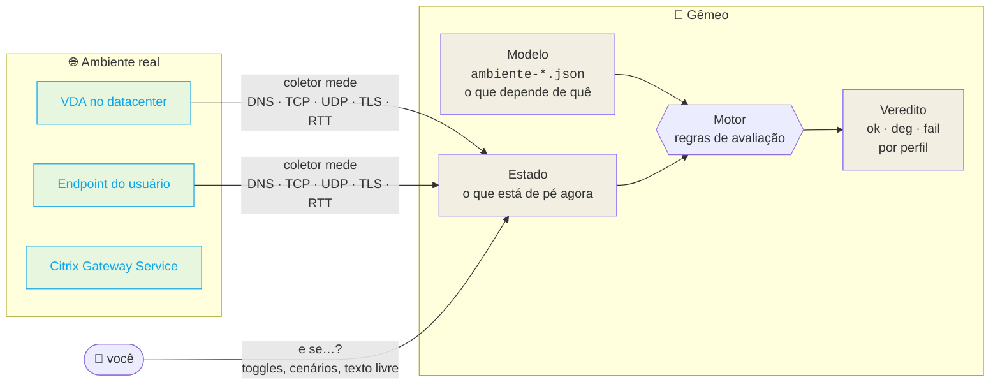

| sem o gêmeo | com o gêmeo |
|---|---|
| "Se o firewall bloquear UDP 443, cai?" → depende de quem você pergunta | o motor responde: **não cai, vai para TCP**, e mostra a assimetria entre as duas pontas |
| A janela de mudança é o teste | a mudança é simulada antes, e a varredura mostra o que ela combina com o resto |
| Incidente: "o portal caiu, quem foi afetado?" | **sessão nova** abre pelo connection lease; **sessão em andamento** nem percebe |
| Diagnóstico escrito à mão, desatualizado | fatos calculados a partir do modelo + evidência medida no momento |

---

## 🏗 Arquitetura

### Os blocos


### Uma implementação, três consumidores

O ponto mais importante da arquitetura: **o motor existe em um lugar só.**

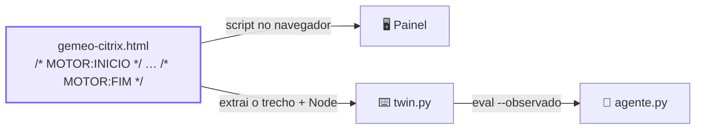

O `twin.py` não reimplementa nada: ele recorta o JavaScript entre os marcadores, injeta `ENV` (o
modelo) e `S` (o estado), e executa no Node. O `agente.py` pega o veredito pelo `twin.py`. Por isso
**painel, agente e linha de comando não têm como discordar** — é o mesmo código, byte a byte.

### A topologia modelada

Três zonas, nove componentes, doze fluxos. Toda conexão parte de dentro para fora: nenhum estágio
usa entrada no VDA.


<sub>Linha grossa = caminho principal do HDX (EDT). Pontilhada = alternativo ou fallback.</sub>

---

## 🧠 O motor por dentro

O motor tem cerca de 380 linhas de JavaScript sem dependência nenhuma. Ele faz uma coisa:
**dado o modelo e o estado, diz em que pé fica cada perfil de sessão.** A lógica cabe numa figura.

<p align="center">
  
</p>

### Passo a passo

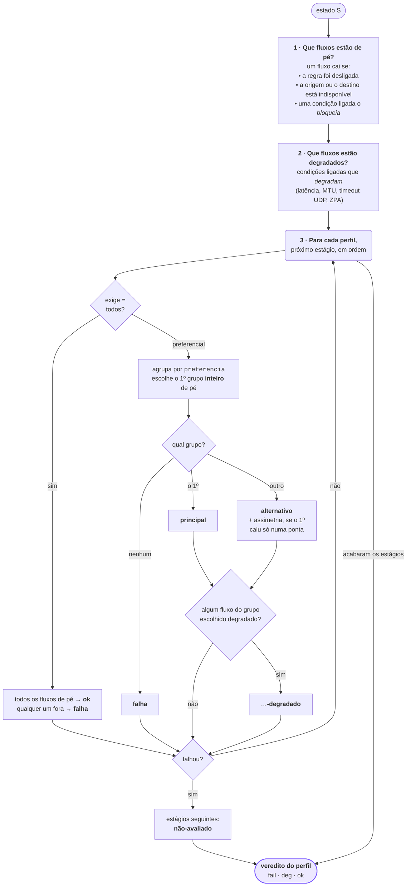

Três ideias carregam todo o resto:

1. **Estágio `todos` é um E lógico.** O registro do VDA precisa de `reg-cloud`, `reg-cc` *e* `ctl-gw`. Um fora, o VDA não é ofertado.
2. **Estágio `preferencial` é uma lista de planos.** O motor tenta o plano ①; se algum fluxo dele estiver fora, tenta o ②; e assim por diante. Dentro de um plano, todos precisam estar de pé — por isso o EDT exige UDP **nas duas pontas**.
3. **Perfis enxergam estágios diferentes.** A sessão nova passa pelos três. A sessão em andamento só depende do transporte. É isso que faz o portal cair sem derrubar quem já está conectado.

### Um exemplo, à mão

> *"O StoreFront Cloud caiu. O que acontece?"* — `python3 twin.py eval ambiente-continuidade.json --no workspace`

| passo | sessão nova | sessão em andamento |
|---|---|---|
| fluxos afetados | `enum-ws` e `broker-daas` (o `workspace` é origem ou destino deles) | — |
| **registro** · todos | `reg-cloud`, `reg-cc`, `ctl-gw` de pé → **ok** | *(fora do perfil)* |
| **autorização** · preferencial | plano ① tem `enum-ws` fora → tenta ② `lease-local` + `lease-gw` → **alternativo** | *(fora do perfil)* |
| **transporte** · preferencial | plano ① `edt-dc` + `edt-cli` de pé → **principal** | **principal** |
| **veredito** | 🟡 `deg` · opera por caminho alternativo · *autorização · connection lease* | 🟢 `ok` · íntegro |

Agora some `--cond lease-expirado=on`: o plano ② também quebra, a autorização **falha**, o transporte
vira **não-avaliado** e a sessão nova vai para 🔴 `fail`. A sessão em andamento continua 🟢.
Nenhum dos dois eventos derruba nada sozinho — **juntos** derrubam. É exatamente o que a varredura
caça.

### Os três níveis

| nível | quando | no painel |
|---|---|---|
| 🟢 `ok` | todo estágio no plano ① e nenhum fluxo em uso degradado | **íntegro** |
| 🟡 `deg` | algum estágio num plano alternativo, ou condição degradando um fluxo em uso | **opera por caminho alternativo** / **opera degradado** |
| 🔴 `fail` | algum estágio sem nenhum plano inteiro | **interrompe em _estágio_** |

Quando dois ou mais fatores de degradação pesam sobre os fluxos em uso, o título ganha
**"N fatores somados"**. O nível continua `deg`: é aviso de risco, não veredito. O limite fica em
`degradacao_composta` no ambiente.

### Do que o motor é feito

| função | papel |
|---|---|
| `resetEstado()` | estado inicial: fluxos no `padrao`, condições desligadas, componentes de pé |
| `aplicarObservado()` | aplica a coleta medida (com aliases) e converte RTT em condição de latência |
| `avaliar()` | calcula bloqueios, degradações e o veredito de todos os perfis |
| `avaliarPerfil()` | a cascata de estágios e planos mostrada acima |
| `validarExtensao()` / `aplicarExtensao()` | valida e acopla as hipóteses `hip-*` da IA |
| `semHipoteses(fn)` | roda qualquer cálculo sobre a topologia revisada, como se as hipóteses não existissem |
| `calcularVarredura()` | testa todos os eventos, um a um e em duplas, e marca as duplas emergentes |

---

## 💥 A varredura: o risco que ninguém procura

O painel responde à falha que você marca. A varredura faz o inverso: **testa todas as combinações
contra o motor** e mostra o que derruba, o que degrada sem dar erro e o que não muda nada.

Números reais do modelo de continuidade, a partir do estado saudável
(`python3 twin.py sweep ambiente-continuidade.json --profundidade 2`):

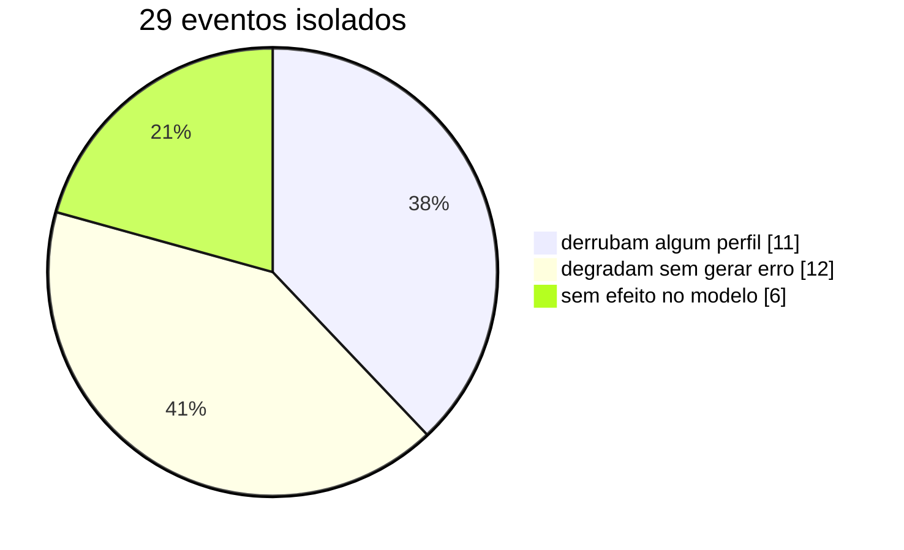

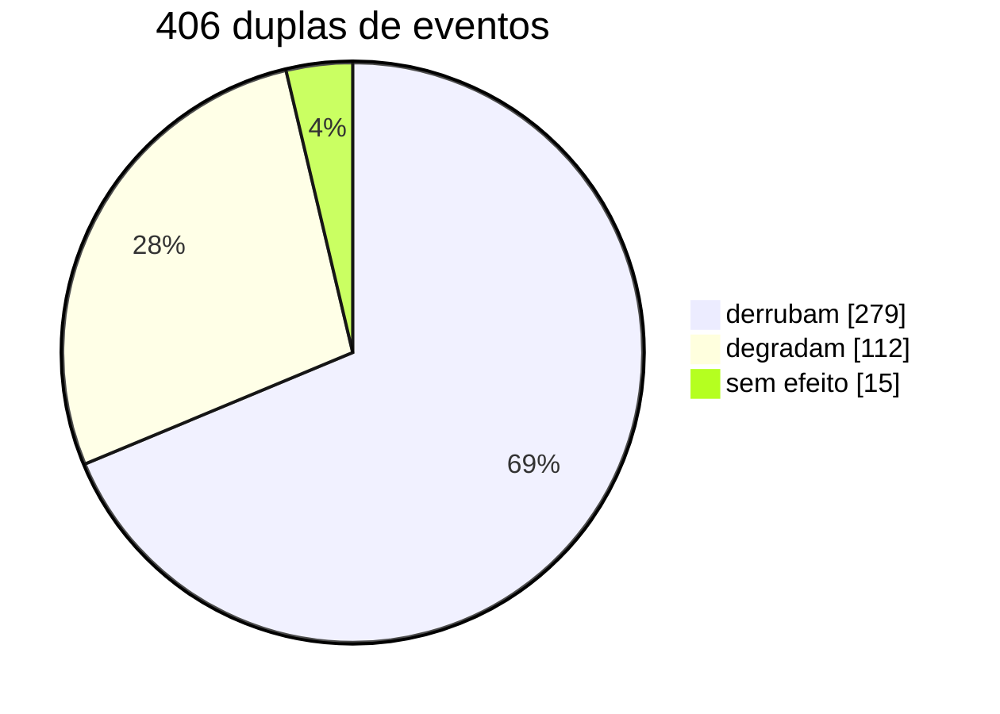

O ouro está nas **29 duplas emergentes**: pares que são piores, em algum perfil, do que cada evento
sozinho. Eventos que isolados não derrubam nada viram queda quando combinados:

| evento A (sozinho: sem efeito ou só degrada) | + evento B | = desfecho |
|---|---|---|
| portal fora (`workspace`) | lease vencido | 🔴 sessão nova não abre |
| UDP fechado no cliente (`edt-cli`) | TCP fechado no datacenter (`tcp-dc`) | 🔴 **as duas sessões caem** |
| UDP fechado no datacenter (`edt-dc`) | inspeção TLS ligada | 🔴 registro falha **e** sessão ativa cai |
| proxy HTTP no HDX | fallback TCP bloqueado | 🔴 as duas sessões caem |
| broker DaaS fora | service continuity desligada | 🔴 sessão nova não abre |

A inspeção TLS é o caso mais traiçoeiro: sozinha, ela só quebra o registro e **tira o fallback TCP em
silêncio**. A sessão ativa continua íntegra pelo EDT — até a primeira perda de UDP, que passa a
derrubar quem já está conectado. O painel lista as emergentes primeiro.

E a outra metade da história — **o que é ponto único de falha hoje**:

| derruba as duas sessões sozinho | derruba só a sessão nova |
|---|---|
| `gw-hdx` · Gateway de dados fora | `reg-cloud`, `reg-cc`, `ctl-gw` bloqueados |
| `ip-fixo` · firewall por IP e o PoP mudou | `cc`, `cloud`, `gw-ctrl` fora |
| | inspeção TLS, cipher suites, Session Reliability off |

---

## 📄 Arquivos de configuração

Cenários ficam separados da topologia de propósito: **a topologia é revisada pela arquitetura, o
cenário é de quem está investigando.**

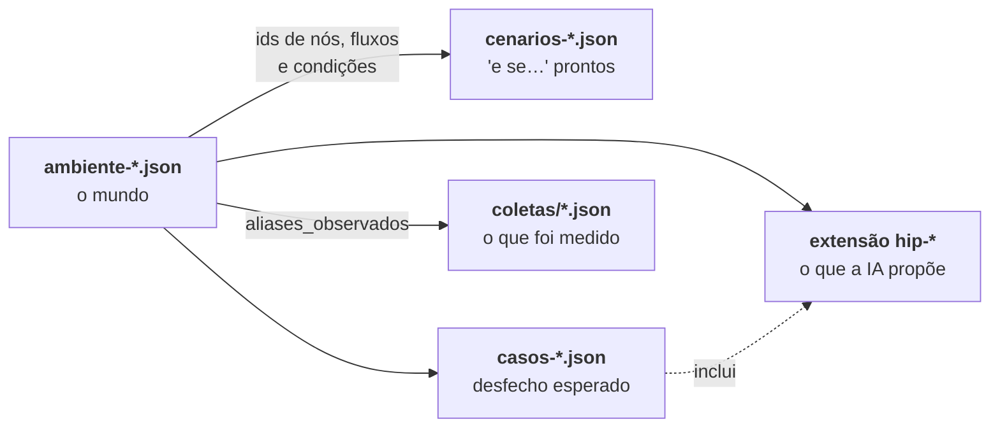

### `ambiente-continuidade.json` — o modelo

É o único arquivo que descreve o mundo. Todo o resto aponta para ids daqui.

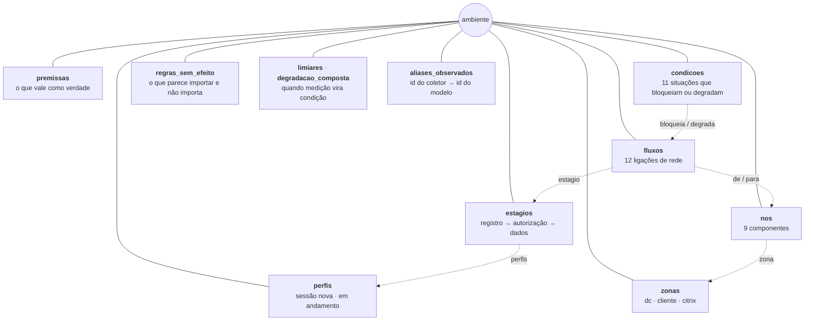

<details open>
<summary><b>perfis, zonas e nós</b></summary>

```jsonc
"perfis": [
  { "id": "sessao-nova",  "nome": "Sessão nova",          "detalhe": "usuário abrindo um recurso agora" },
  { "id": "sessao-ativa", "nome": "Sessão em andamento",  "detalhe": "usuário já conectado" }
],
"zonas": [
  { "id": "dc", "nome": "Datacenter", "tipo": "proprio", "cor": "amber" }   // proprio · terceiro · fornecedor
],
"nos": [
  { "id": "vda",       "nome": "VDA",              "zona": "dc",     "disponibilidade": false },
  { "id": "workspace", "nome": "StoreFront Cloud", "zona": "citrix", "disponibilidade": true  }
  //                                                                  ↑ true = vira um toggle "componente de pé"
]
```

`disponibilidade: true` diz que o componente pode cair. Ele ganha um toggle, entra na varredura, e
quando cai derruba todo fluxo que sai dele ou chega nele. O `VDA` e o `Endpoint` ficam `false`: se
eles caírem, não há sessão para analisar.

</details>

<details open>
<summary><b>estagios — as etapas da sessão</b></summary>

```jsonc
{
  "id": "dados",
  "nome": "Transporte HDX",
  "ordem": 3,                                   // ordem de avaliação
  "exige": "preferencial",                      // "todos" = E lógico · "preferencial" = planos em cascata
  "perfis": ["sessao-nova", "sessao-ativa"],    // quem passa por esta etapa (ausente = todos)
  "caminhos": { "1": "EDT sobre UDP 443", "2": "TCP 443" },   // nome de cada plano, vai pro veredito
  "ok":    "caminho de tela estabelecido",
  "falha": "nenhum caminho chega ao dado HDX"
}
```

</details>

<details open>
<summary><b>fluxos — as ligações de rede</b></summary>

```jsonc
{
  "id": "edt-cli",
  "nome": "EDT saída do cliente",
  "de": "endpoint", "para": "gw-hdx",          // nós; se um deles cair, o fluxo cai
  "proto": "UDP", "porta": 443,                 // TCP · UDP · LOCAL
  "destino": "*.*.nssvc.net",                   // o que a regra de firewall libera
  "zona": "cliente",                            // em qual firewall a regra mora
  "estagio": "dados",
  "papel": "principal",                         // principal · fallback · alternativo
  "preferencia": 1,                             // o plano do estágio; mesmo número = mesmo plano
  "padrao": true                                // a regra existe hoje?
}
```

O par `estagio` + `preferencia` é o que dá significado ao fluxo:

| situação | efeito |
|---|---|
| mesma preferência que outros fluxos | **dependência a mais** daquele plano — se cair, o plano cai |
| preferência nova | **caminho alternativo** — só é usado se os planos anteriores caírem |

</details>

<details open>
<summary><b>condicoes — o que bloqueia ou degrada sem ser regra de firewall</b></summary>

```jsonc
{
  "id": "inspecao-tls",
  "nome": "Inspeção TLS na saída do datacenter",
  "zona": "dc",
  "bloqueia": ["reg-cloud", "ctl-gw", "tcp-dc"],
  "fonte": "Rendezvous V2 — proxy configuration: decriptação e inspeção não suportadas"
},
{
  "id": "mtu",
  "nome": "MTU reduzida / fragmentação bloqueada",
  "zona": "dc",
  "degrada": ["edt-dc"],                        // não derruba: marca o fluxo em uso como instável
  "efeito": "instavel",
  "fonte": "comportamento de rede, não da Citrix"
}
```

`bloqueia` tira o fluxo do ar. `degrada` mantém o fluxo, mas rebaixa o estágio para `-degradado`.
O campo `fonte` é obrigatório na prática: é ele que aparece em **Fatos do motor** e que a IA cita.

| condições do modelo de continuidade | tipo |
|---|---|
| `inspecao-tls`, `proxy-http-hdx`, `cipher-suite`, `session-reliability-off`, `ip-fixo` | bloqueia |
| `service-continuity-off`, `lease-expirado` | bloqueia o lease |
| `udp-timeout`, `mtu`, `zpa-sem-bypass`, `latencia-alta` | degrada |

</details>

<details>
<summary><b>regras_sem_efeito, limiares, degradacao_composta, aliases_observados</b></summary>

```jsonc
"regras_sem_efeito": [
  { "id": "legacy", "nome": "UDP 2598 / TCP 1494 no VDA", "zona": "dc",
    "veredito": "Com Rendezvous V2 o dado vai todo em 443." }
],
```
Regras que alguém **vai** pedir para abrir e que não mudam nada. Elas aparecem no painel para a
resposta ser explícita, não para o motor calcular.

```jsonc
"limiares": {
  "rtt_ms": {
    "aviso": 150,                               // acima disso…
    "condicao": "latencia-alta",                // …esta condição liga sozinha
    "fluxos": ["ctl-gw", "lease-gw", "edt-dc", "tcp-dc", "edt-cli", "tcp-cli"]
  }
},
"degradacao_composta": { "limite": 2 },        // 2+ fatores sobre fluxos em uso → "N fatores somados"
"aliases_observados": {                         // id gravado pelo coletor → id deste modelo
  "tls": "inspecao-tls", "proxy-tcp": "proxy-http-hdx", "ctl": "ctl-gw", "reg": "reg-cloud"
}
```
Só contam para o limiar os fluxos que vão até o Gateway: RTT alto do registro no Citrix Cloud não é
latência de sessão.

</details>

### `cenarios-continuidade.json` — falhas prontas

Cada cenário é um conjunto de ajustes sobre o estado padrão. Viram botões na lateral do painel.

```jsonc
{
  "id": "lease-vencido",
  "nome": "Portal fora e lease vencido",
  "detalhe": "passou dos 7 dias sem sincronizar",
  "aplica": {
    "nos":        { "workspace": false },         // componente fora
    "condicoes":  { "lease-expirado": true },     // condição ligada
    "fluxos":     { },                            // regra desligada: { "edt-dc": false }
    "sem_efeito": { }                             // regra inócua marcada
  }
}
```

### `casos-continuidade.json` — o contrato

O que o modelo **promete** responder. O `twin.py test` roda cada caso contra o motor e compara.

```jsonc
{
  "nome": "portal do usuario fora: lease assume, sessao ativa intacta",
  "aplica": { "nos": { "workspace": false } },
  "espera": {
    "Sessão nova":         { "nivel": "deg", "estagios": { "autorizacao": "alternativo", "dados": "principal" } },
    "Sessão em andamento": { "nivel": "ok" }
  }
}
```

`espera` aceita só o que importa para o caso: o nível, e opcionalmente o status de cada estágio
(`ok`, `principal`, `alternativo`, `principal-degradado`, `alternativo-degradado`, `falha`,
`nao-avaliado`). Um caso pode trazer `extensao` com hipóteses `hip-*` — os que começam com
"hipotese" no nome servem de exemplo.

### `coletas/*.json` — o estado medido

```jsonc
{
  "schema": "gemeo-citrix-observado/1.2",
  "coletado_em": "2026-09-14T15:00:00+00:00",
  "fluxos": {
    "edt-dc":  { "estado": "ok",        "ponto": "vda-01",             "rtt_ms": 251 },
    "edt-cli": { "estado": "bloqueado", "ponto": "estacao-cliente-01", "erro": "sem resposta em 4s" }
  },
  "condicoes": { "tls": false, "ip-fixo": false, "proxy-tcp": false },
  "dns": { … }, "tls": { … }, "medicoes": { … }
}
```

Como a coleta entra no motor (`aplicarObservado()`):

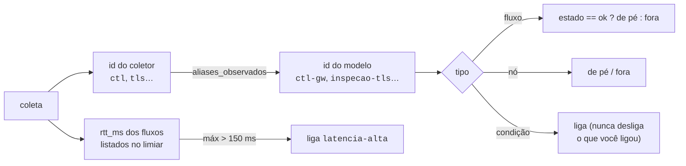

Fluxo medido sem correspondência no modelo aparece na evidência como "fora do modelo".

---

## 🖥 O painel

| bloco | o que mostra |
|---|---|
| **Veredito** | um bloco por perfil, com o status de cada estágio |
| **Fluxo de rede** | o diagrama, pintado pelo perfil selecionado: verde em uso, âmbar degradado, cinza liberado e ocioso, vermelho bloqueado |
| **Validar uma mudança** | você descreve a mudança em texto, a IA traduz para estado, o motor recalcula |
| **Fatos do motor** | o que está bloqueado ou degradado, por qual causa e em qual zona — calculado, sem texto à mão |
| **Evidência medida** | o que veio do coletor. Sem coleta, avisa na cara que tudo é o modelo respondendo ao que você marcou |
| **Análise** | a IA. Fica vazia até você mandar analisar |
| **Varredura de falhas** | 1 ou 2 eventos, com as duplas emergentes primeiro |

<p align="center">
  
  <br><sub>Fatos do motor (calculados) ao lado da evidência medida (coletada). Note a <b>assimetria</b>: o EDT está aberto no datacenter e fechado no cliente — e o plano ① exige as duas pontas.</sub>
</p>

---

## 🤖 A IA traduz, o motor decide

A IA faz **duas traduções e nenhuma decisão**: texto para estado, e resultado para texto. Ela não
pode contradizer o veredito do motor, não pode citar número que não esteja no contexto, e cada causa
que ela levanta precisa declarar em que dado se apoia.

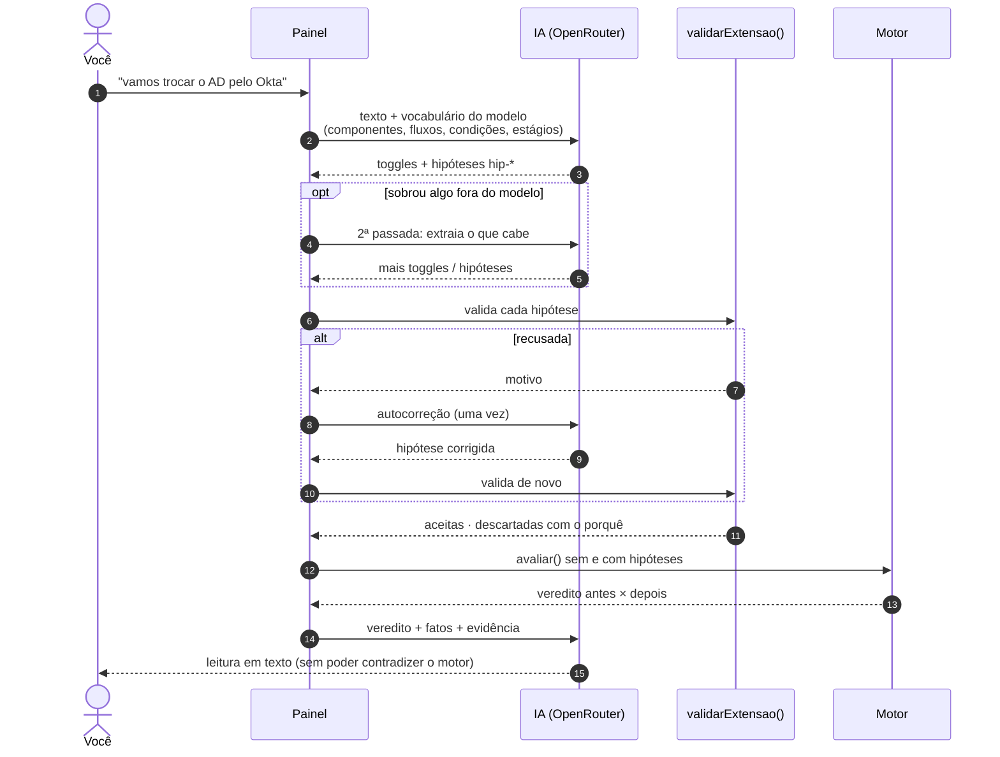

### Hipóteses `hip-*`

Quando a pergunta descreve algo que o modelo não tem — SD-WAN sem UDP, firewall novo, QoS, proxy,
um IdP novo — a IA declara uma **hipótese**: componente, fluxo e/ou condição, sempre com
justificativa. O teste que decide é o de disponibilidade: *se a coisa nova ficar fora do ar, alguma
etapa para de funcionar?* Então é dependência, e vira componente e fluxo.

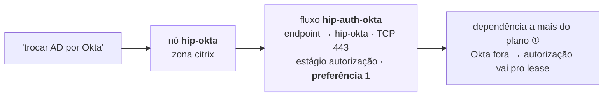

| regra do validador | por quê |
|---|---|
| id `hip-[a-z0-9-]+`, sem repetir | hipótese nunca sobrescreve o que foi revisado |
| zona, nós, estágio e fluxos precisam existir | não dá para inventar etapa nova |
| proto `TCP`/`UDP`/`LOCAL`, porta 1–65535, preferência 1–9 | tem que ser uma regra de firewall real |
| nome e justificativa obrigatórios | quem levar à topologia precisa do porquê |
| no máximo 5 de cada tipo por pergunta | hipótese é pontual, não um modelo paralelo |
| componente sem fluxo novo é descartado | não mudaria nada no motor |
| o mesmo fluxo não pode ser bloqueado e degradado | contradição |

A hipótese **só acrescenta**: não remove nem redireciona fluxo existente. Ela aparece separada, em
violeta, e o painel entrega a condição já no esquema do ambiente, com um caso de teste, para quem
for levar à topologia. Se a hipótese estiver errada, o veredito também está — por isso a análise é
instruída a não usá-la como evidência.

Só fica fora o que muda a regra de avaliação (estágio novo, lógica de decisão) ou o funcionamento
interno de algo sem mudar do que ele depende — validade de token, por exemplo.

### Configurar

```bash
cp credenciais.local.json.exemplo credenciais.local.json
```
```json
{ "openrouter_key": "sk-or-v1-...", "modelo": "anthropic/claude-sonnet-5" }
```

O arquivo está no `.gitignore` e o `gemeo-citrix.html` nunca contém a chave. Sem ele, dá para
digitar a chave no painel em *Fontes e integrações* — aí ela fica só na memória da aba.

---

## 📡 Medir o ambiente de verdade

### Um ensaio de 5 minutos, ao vivo

Coletor real a cada ~11 s, o painel aberto, e a rede da máquina sendo maltratada no meio do caminho.
Esta é a série de RTT máximo até o Gateway, medida em 18/09 entre 20h21 e 20h26 (eixo em mm:ss;
zero = o nome nem resolveu):

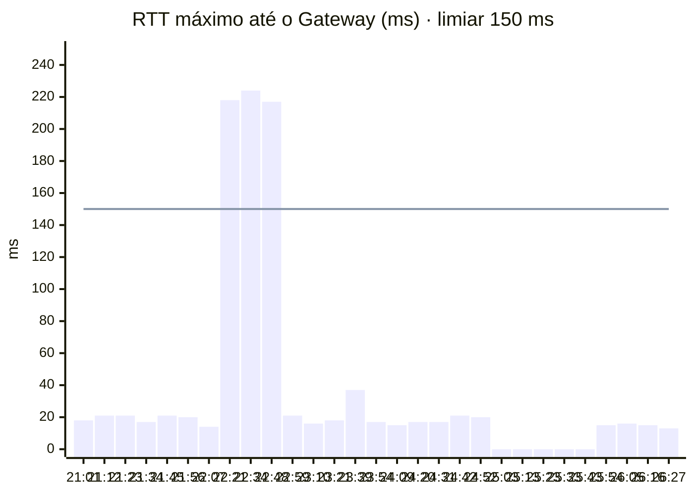

| janela (mm:ss) | o que a coleta mostrou | o que o motor disse, sozinho |
|---|---|---|
| 21:01 – 22:07 | RTT ~20 ms, tudo ok | 🟢 íntegro · íntegro |
| 22:21 – 22:48 | RTT salta para ~220 ms (+200 ms de atraso) | 🟡 **opera degradado** — `latencia-alta` ligou pelo limiar |
| 23:39 – 24:09 | `edt-dc` bloqueado: UDP 443 sem resposta | 🟡 **caminho alternativo** — EDT caiu, TCP 443 assumiu |
| 25:03 – 25:43 | `ctl-gw` e `reg-cloud` sem resolver nome | 🔴 sessão nova **interrompe em registro** · 🟢 sessão ativa **íntegra** |
| 25:54 → | tudo de volta | 🟢 íntegro · íntegro |

Nenhum toggle foi tocado. O painel releu `coletas/atual.json` a cada ciclo e o motor fez o resto.

### Ciclo completo — quatro terminais

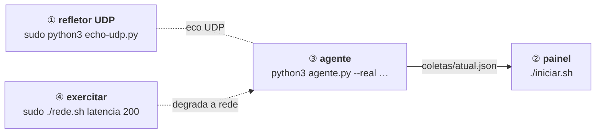

```bash
# 1 · refletor UDP
sudo python3 echo-udp.py

# 2 · painel
./iniciar.sh

# 3 · agente medindo de verdade
python3 agente.py --real --intervalo 10 \
  --customer-id SEU_CCID \
  --alvo ctl-gw=global.g.nssvc.net \
  --refletor-udp 127.0.0.1

# 4 · exercitar
sudo ./rede.sh latencia 200
sudo ./rede.sh normal
sudo ./rede.sh bloqueia-udp
sudo ./rede.sh normal
```

Espere dois ciclos do agente entre um comando e outro para o painel reagir.

**Sem depender da rede**, o agente reproduz estados já gravados — é a opção quando a conexão não
pode ser variável de risco (numa demo, por exemplo):

```bash
python3 agente.py --roteiro roteiro.json --intervalo 15 --repetir
```

O `roteiro.json` incluso conta a história de uma degradação progressiva:

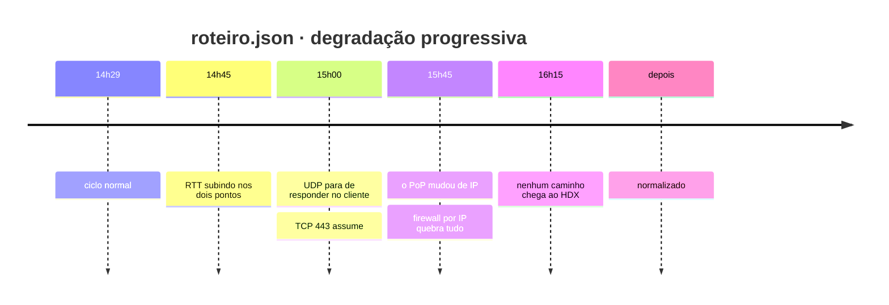

### Coletar dos dois lados

O modelo tem duas pontas saindo para o mesmo Gateway, e o EDT só sobe com UDP aberto nas duas.
**Um coletor só enxerga um lado.**

```bash
# No VDA
python3 coletor-citrix.py --customer-id SEU_CCID \
    --alvo ctl-gw=global.g.nssvc.net \
    --refletor-udp echo.seudominio.com \
    --saida estado-dc.json

# Numa máquina da rede do cliente, pela mesma rota de saída do usuário
python3 coletor-citrix.py --alvo tcp-cli=global.g.nssvc.net \
    --refletor-udp echo.seudominio.com \
    --saida estado-cliente.json

# Juntar
python3 twin.py merge estado-dc.json estado-cliente.json \
    --mapear ctl=ctl-gw --mapear reg=reg-cloud \
    --anonimizar --saida coletas/atual.json
```

O coletor grava ids genéricos (`ctl`, `reg`, `tls`, `proxy-tcp`); cada ambiente traduz em
`aliases_observados`. Para qualquer outro, o id do `--alvo` precisa bater com o id de fluxo do
ambiente. O `--anonimizar` mascara o identificador de tenant nos FQDN, para material que vai virar
público.

<details>
<summary><b>Sobre os alvos: wildcard não resolve</b></summary>

Os requisitos de firewall da Citrix são wildcards:

- `*.*.nssvc.net` tem dois níveis de curinga. Um host real e resolvível do Gateway Service é `global.g.nssvc.net`.
- `*.xendesktop.net` responde sem registro para subdomínio inexistente. O alvo testável é `<CCID>.xendesktop.net`, com o Customer ID do Citrix Cloud.

Para descobrir qual PoP este host está usando de fato, com uma sessão aberta:

```bash
python3 coletor-citrix.py --descobrir
```

</details>

### Simular degradação na sua máquina (macOS)

> [!WARNING]
> Os comandos abaixo mexem no firewall da sua máquina. **Ensaie o desfazer antes de precisar dele.**
> Se algo ficar estranho, reiniciar o Mac devolve tudo — nada disso persiste.

| simular | ligar | desligar | o painel vê? |
|---|---|---|---|
| latência | `sudo ./rede.sh latencia 200` | `sudo ./rede.sh normal` | ✅ RTT > 150 ms liga `latencia-alta` |
| perda de pacote | `sudo ./rede.sh perda 5` | `sudo ./rede.sh normal` | ❌ o coletor mede tempo de conexão, não descarte |
| UDP 443 bloqueado | `sudo ./rede.sh bloqueia-udp` | `sudo ./rede.sh normal` | ✅ **se** o refletor UDP estiver rodando |
| o que está ativo | `./rede.sh status` | | |

<details>
<summary><b>Os comandos por baixo do <code>rede.sh</code></b></summary>

**Latência** — dois comandos, e os dois são necessários: o `dnctl` cria o pipe, o `pfctl` manda o
tráfego para dentro dele.

```bash
sudo dnctl pipe 1 config delay 200
echo "dummynet out proto {tcp,udp} to any port 443 pipe 1" | sudo pfctl -f - -E

# desfazer
sudo pfctl -d
sudo dnctl -q flush
sudo pfctl -f /etc/pf.conf
```

O `delay` é por sentido e a regra é só de saída, então o RTT sobe cerca de 200 ms, não 400.

**Perda de pacote**

```bash
sudo dnctl pipe 1 config plr 0.05
echo "dummynet out proto {tcp,udp} to any port 443 pipe 1" | sudo pfctl -f - -E
```

A sessão degrada de verdade, mas o modelo não enxerga perda. Latência é o que vira condição hoje.

**Bloquear UDP 443**

```bash
echo "block drop out proto udp to any port 443" | sudo pfctl -f - -E

# desfazer
sudo pfctl -d
sudo pfctl -f /etc/pf.conf
```

Sem refletor, o coletor marca o UDP como `nao-testado` e o campo nem entra no arquivo — o bloqueio
não muda nada no painel. Suba o refletor (`sudo python3 echo-udp.py`) e aponte o coletor com
`--refletor-udp`. Com refletor em loopback ou rede privada, a medição sai com aviso: vale para
exercitar o modelo, não prova que a saída UDP 443 até o Gateway está aberta.

**Conferir o que está ativo**

```bash
sudo dnctl list
sudo pfctl -s info | head -2
sudo pfctl -s rules
```

O `-E` do `pfctl` conta referências: se você ligou mais de uma vez, precisa de um `pfctl -d` para
cada vez, até o `pfctl -s info` dizer `Status: Disabled`.

</details>

---

## ⌨️ Testes e linha de comando

```bash
python3 twin.py check ambiente-continuidade.json --cenarios cenarios-continuidade.json
python3 twin.py test  casos-continuidade.json
```

| comando | o que faz |
|---|---|
| `check` | procura referência quebrada, id repetido, estágio sem fluxo, nó órfão, cenário apontando para o nada. Não precisa de Node |
| `test` | roda os casos esperados contra o motor (hoje: **48 de 48**) |
| `eval` | avalia um estado e imprime o veredito por perfil e estágio |
| `sweep` | varredura de 1 ou 2 eventos, com as duplas emergentes |
| `merge` | junta coletas de pontos diferentes, mapeia ids e anonimiza |

`check` e `test` devolvem código de saída diferente de zero quando falham — dá para pendurar num
hook de commit.

```bash
python3 twin.py eval ambiente-continuidade.json --no workspace          # componente fora
python3 twin.py eval ambiente-continuidade.json --fluxo edt-cli=off     # regra bloqueada
python3 twin.py eval ambiente-continuidade.json --cond inspecao-tls=on  # condição ligada
python3 twin.py eval ambiente-continuidade.json --observado coletas/atual.json
python3 twin.py eval ambiente-continuidade.json --extensao hipotese.json

python3 twin.py sweep ambiente-continuidade.json
python3 twin.py sweep ambiente-continuidade.json --profundidade 2 --mostrar-duplas
python3 twin.py sweep ambiente-continuidade.json --extensao hipotese.json
```

O `--observado` aplica a coleta pelo mesmo `aplicarObservado()` do painel, e os demais ajustes
entram por cima. O arquivo de `--extensao` tem o mesmo formato que a IA devolve:
`{"nos": [...], "fluxos": [...], "condicoes": [...]}`, com ids `hip-*`.

### `iniciar.sh`

```bash
PORTA=8788 ./iniciar.sh
OBSERVADO=coletas/2026-09-14_1545.json ./iniciar.sh
ATUALIZAR=0 ./iniciar.sh                      # desliga a releitura automática
AMBIENTE=ambiente-rendezvous-v2.json CENARIOS=cenarios-rendezvous-v2.json ./iniciar.sh
```

Precisa de `python3`. Com `node` instalado, também valida o motor antes de abrir.

---

## 🗂 Mapa dos arquivos

```
.
├── gemeo-citrix.html             painel inteiro; o motor mora entre MOTOR:INICIO e MOTOR:FIM
├── iniciar.sh                    valida, sobe o servidor e abre o navegador
│
├── ambiente-continuidade.json    modelo principal: sessão nova × em andamento, service continuity
├── ambiente-rendezvous-v2.json   modelo do caminho de rede, sem perfis de ciclo de vida
├── cenarios-continuidade.json    falhas prontas do modelo principal
├── cenarios-rendezvous-v2.json   falhas prontas do modelo base
├── casos-continuidade.json       suíte de desfechos esperados
│
├── twin.py                       CLI: check · eval · sweep · test · merge          (sua máquina)
├── coletor-citrix.py             mede DNS, TCP, UDP, TLS e RTT                     (VDA e rede do cliente)
├── agente.py                     coleta em laço e publica coletas/atual.json       (onde o coletor roda)
├── echo-udp.py                   refletor UDP; sem ele o UDP não é medido          (fora da rede testada)
├── rede.sh                       degrada ou bloqueia a rede local                  (macOS)
│
├── coletas/                      histórico de estados observados; atual.json é o corrente
│   └── index.json                índice com data, pontos e contagem de falhas
├── roteiro.json                  sequência de estados para o agente reproduzir
├── credenciais.local.json        chave do OpenRouter — no .gitignore, nunca no repositório
└── docs/img/                     imagens deste README
```

> [!NOTE]
> Coletas reais carregam tenant e hostname, então o `.gitignore` só deixa entrar os exemplos
> anonimizados de `coletas/2026-09-14_*.json`.

---

## 🧭 Limites do modelo

As premissas estão no topo de cada `ambiente-*.json`. As do modelo de continuidade:

- máquinas **AD domain joined** — o Cloud Connector fica no caminho de registro e autorização;
- acesso via **StoreFront Cloud** e **Citrix Gateway Service**;
- **Session Reliability** habilitada (requisito do Rendezvous);
- autenticação federada no IdP **não modelada**;
- o **mesmo protocolo de transporte nas duas pernas** — EDT numa e TCP na outra conta como sem caminho. É a hipótese que mais vale validar em laboratório.

> [!IMPORTANT]
> O modelo ainda não foi confrontado com laboratório. Os casos em `casos-continuidade.json` dizem
> que ele é **coerente consigo mesmo**, não que corresponde ao ambiente. Quando um teste real
> contradisser um caso, corrija o modelo e o caso juntos, para não regredir.

Pergunta aberta que não traduz para o estado é informação útil: cada uma delas é uma coisa que o
modelo deveria representar e não representa.
