<p align="center">
  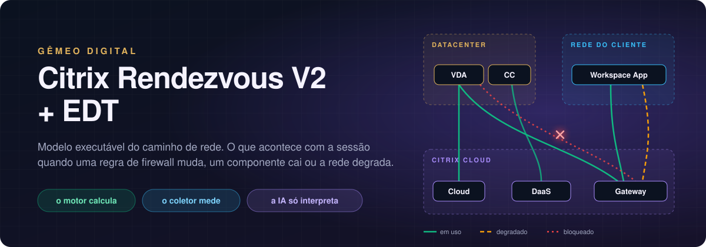
</p>

# Gêmeo digital: Citrix Rendezvous V2 + EDT

Modelo executável do caminho de rede entre o VDA, o Citrix Cloud, o Gateway Service e o endpoint
do usuário. Responde o que acontece com a sessão quando uma regra de firewall muda, quando um
componente cai ou quando a rede degrada.

O motor calcula, o coletor mede e a IA só interpreta. Quem decide o desfecho é sempre o motor.

## Começar

```bash
./iniciar.sh
```

O `iniciar.sh` valida o modelo, roda a suíte de testes, sobe um servidor local e abre o navegador
já com tudo carregado. É servidor estático: não há backend nem API, e nada sai da máquina além das
chamadas que você fizer à IA.

```bash
PORTA=8788 ./iniciar.sh
OBSERVADO=coletas/2026-09-14_1545.json ./iniciar.sh
ATUALIZAR=0 ./iniciar.sh                      # desliga a releitura automática
AMBIENTE=ambiente-rendezvous-v2.json CENARIOS=cenarios-rendezvous-v2.json ./iniciar.sh
```

Precisa de `python3`. Com `node` instalado, o `iniciar.sh` também valida o motor.

<p align="center">
  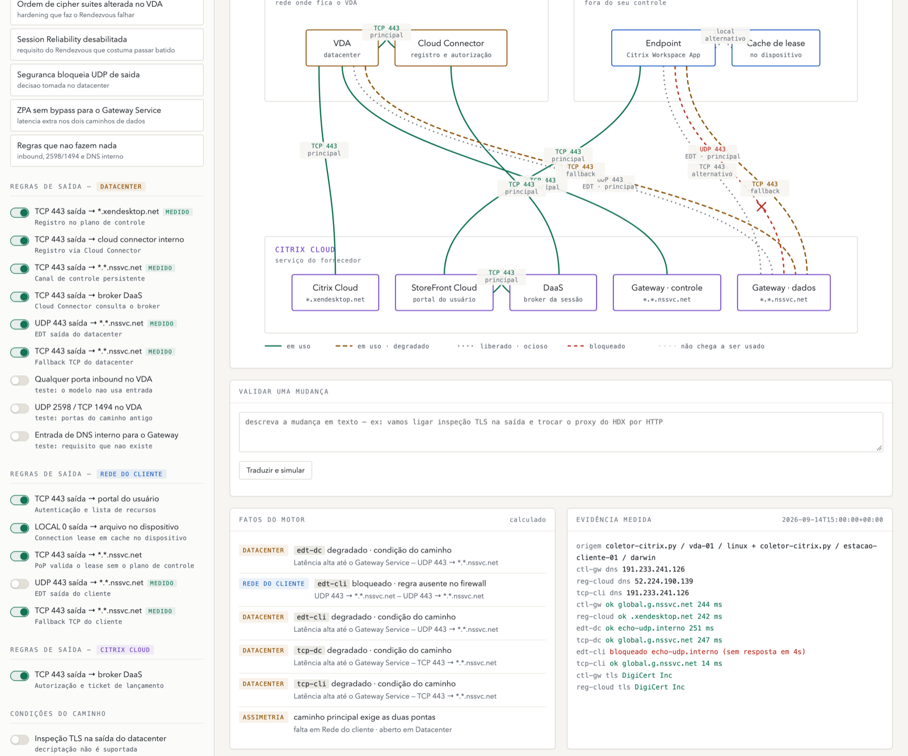
  <br><sub>Painel carregado com a coleta das 15h00: UDP bloqueado na ponta do cliente, a sessão vai para TCP 443 e o veredito fica em caminho alternativo. Nenhum toggle foi mexido.</sub>
</p>

## Como as peças se encaixam

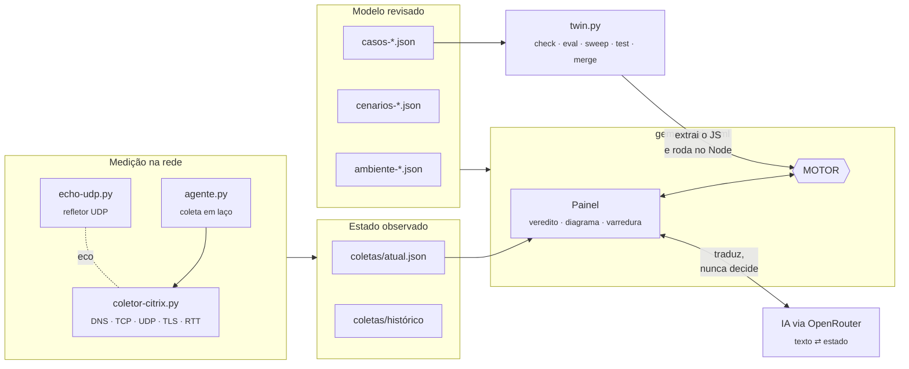

O motor mora dentro do `gemeo-citrix.html`, entre os marcadores `MOTOR:INICIO` e `MOTOR:FIM`. O
`twin.py` não reimplementa nada: recorta esse trecho, injeta o modelo e o estado e executa no Node.
O `agente.py` pega o veredito pelo `twin.py`. Painel, agente e linha de comando rodam o mesmo
código, então não têm como discordar.

A topologia do modelo de continuidade tem três zonas, nove componentes e doze fluxos. Todo tráfego
parte de dentro para fora; nenhum estágio usa conexão de entrada no VDA.

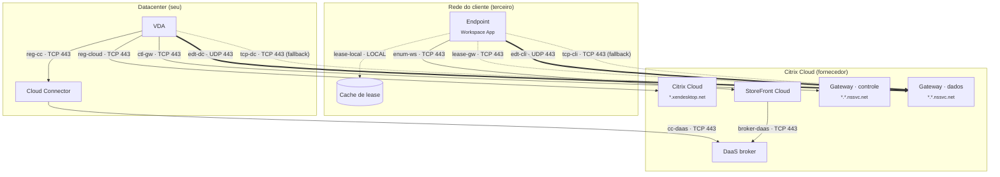

<sub>Linha grossa: caminho principal do HDX (EDT). Pontilhada: alternativo ou fallback.</sub>

## O motor

São umas 380 linhas de JavaScript sem dependência. Recebem o modelo (`ENV`) e o estado (`S`) e
devolvem o veredito de cada perfil de sessão.

<p align="center">
  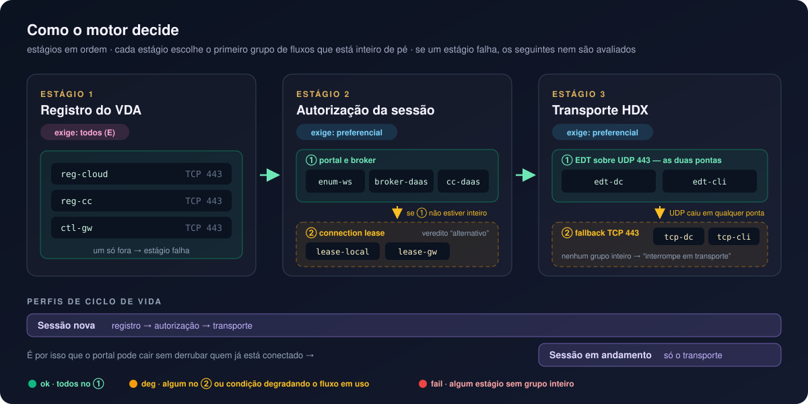
</p>

Primeiro ele descobre quais fluxos estão de pé. Um fluxo cai quando a regra foi desligada, quando a
origem ou o destino está indisponível, ou quando alguma condição ligada o bloqueia. Condições que
degradam (latência, MTU, timeout UDP, ZPA) não derrubam o fluxo, só marcam.

Depois percorre os estágios em ordem, para cada perfil. O estágio tem um de dois modos:

- `todos`: todos os fluxos precisam estar de pé. É o caso do registro do VDA (`reg-cloud`, `reg-cc` e `ctl-gw`).
- `preferencial`: os fluxos são agrupados pelo campo `preferencia` e o motor fica com o primeiro grupo que estiver inteiro. No transporte, o grupo 1 é EDT nas duas pontas e o grupo 2 é TCP nas duas pontas. Se o UDP cair só no cliente, o grupo 1 não está inteiro e a sessão vai para TCP.

Se um estágio falha, os seguintes ficam como `nao-avaliado`. Não faz sentido avaliar transporte de
uma sessão que não foi autorizada.

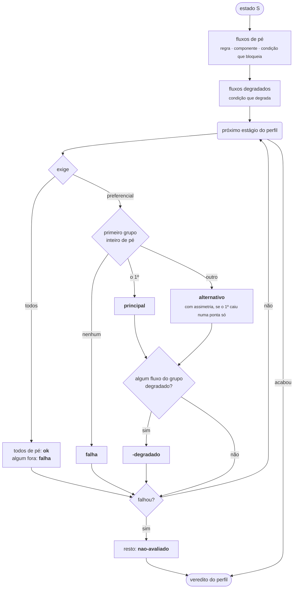

Os perfis enxergam estágios diferentes. Sessão nova passa por registro, autorização e transporte.
Sessão em andamento só depende do transporte, e é por isso que o portal pode cair sem derrubar quem
já está conectado.

O nível final do perfil sai assim:

| nível | quando |
|---|---|
| `ok` | todos os estágios no grupo 1, nenhum fluxo em uso degradado |
| `deg` | algum estágio num grupo alternativo, ou condição degradando fluxo em uso |
| `fail` | algum estágio sem nenhum grupo inteiro |

Quando dois ou mais fatores de degradação pesam sobre os fluxos em uso, o título ganha "N fatores
somados". O nível continua `deg`: é aviso de risco, não veredito. O limite fica em
`degradacao_composta` no ambiente.

### Exemplo: o StoreFront caiu

```bash
python3 twin.py eval ambiente-continuidade.json --no workspace
```

O `workspace` é ponta de `enum-ws` e `broker-daas`, então os dois caem.

| estágio | sessão nova | sessão em andamento |
|---|---|---|
| registro (todos) | os três fluxos de pé: `ok` | fora do perfil |
| autorização (preferencial) | grupo 1 sem `enum-ws`; grupo 2 (lease) inteiro: `alternativo` | fora do perfil |
| transporte (preferencial) | EDT nas duas pontas: `principal` | `principal` |
| **veredito** | `deg`, opera por caminho alternativo | `ok`, íntegro |

Com `--cond lease-expirado=on` junto, o grupo 2 da autorização também quebra. A autorização falha,
o transporte fica sem avaliar e a sessão nova vai para `fail`. A sessão em andamento continua `ok`.
Nenhum dos dois eventos derruba nada sozinho.

### Funções

| função | o que faz |
|---|---|
| `resetEstado()` | estado inicial: fluxos no `padrao`, condições desligadas, componentes de pé |
| `aplicarObservado()` | aplica a coleta (com aliases) e converte RTT em condição de latência |
| `avaliar()` | bloqueios, degradações e veredito de todos os perfis |
| `avaliarPerfil()` | percorre os estágios de um perfil |
| `validarExtensao()`, `aplicarExtensao()` | validam e acoplam as hipóteses `hip-*` |
| `semHipoteses(fn)` | roda um cálculo sobre a topologia revisada, ignorando as hipóteses |
| `calcularVarredura()` | testa eventos um a um e em duplas e marca as duplas emergentes |

## Varredura

O painel responde à falha que você marca. A varredura faz o inverso: testa todas as combinações de
um ou dois eventos contra o motor e separa o que derruba, o que degrada sem gerar erro e o que não
muda nada.

Resultado atual do modelo de continuidade, partindo do estado saudável:

```bash
python3 twin.py sweep ambiente-continuidade.json --profundidade 2
```

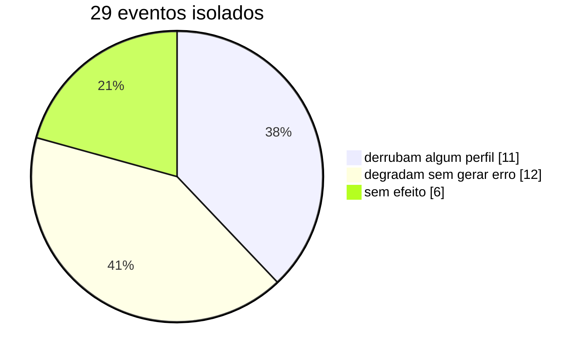

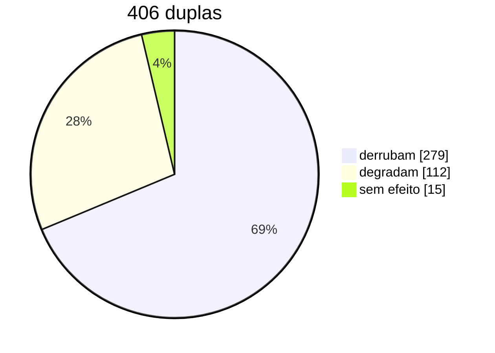

O que interessa na profundidade 2 são as duplas emergentes, que são piores em algum perfil do que
cada evento sozinho. Hoje são 29. Algumas:

| evento A | evento B | resultado |
|---|---|---|
| portal fora | lease vencido | sessão nova não abre |
| UDP fechado no cliente (`edt-cli`) | TCP fechado no datacenter (`tcp-dc`) | as duas sessões caem |
| UDP fechado no datacenter (`edt-dc`) | inspeção TLS | registro falha e a sessão ativa cai |
| proxy HTTP no HDX | fallback TCP bloqueado | as duas sessões caem |
| broker DaaS fora | service continuity desligada | sessão nova não abre |

A inspeção TLS merece atenção. Sozinha ela quebra o registro e tira o fallback TCP sem aviso. A
sessão ativa segue pelo EDT, mas a partir daí qualquer perda de UDP derruba quem já está conectado.
O painel lista as emergentes primeiro.

Os eventos que derrubam sozinhos:

- **as duas sessões**: `gw-hdx` (Gateway de dados fora) e `ip-fixo` (firewall liberando por IP e o PoP mudou).
- **só a sessão nova**: `reg-cloud`, `reg-cc`, `ctl-gw` bloqueados; `cc`, `cloud`, `gw-ctrl` fora; inspeção TLS, cipher suites, Session Reliability desligada.

## Arquivos de configuração

Cenários ficam separados da topologia de propósito: a topologia é revisada pela arquitetura, o
cenário é de quem está investigando.

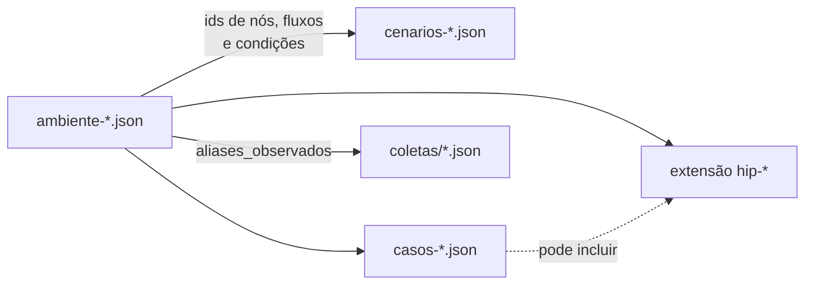

### ambiente-continuidade.json

É o único arquivo que descreve o mundo. Todos os outros apontam para ids daqui.

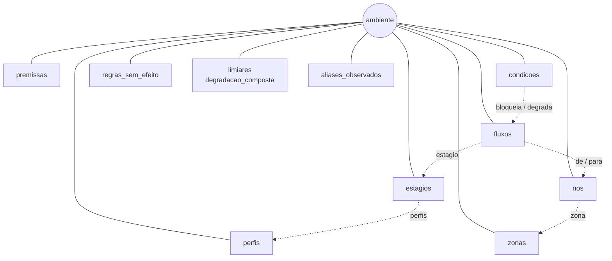

**Perfis, zonas e nós.**

```jsonc
"perfis": [
  { "id": "sessao-nova",  "nome": "Sessão nova",         "detalhe": "usuário abrindo um recurso agora" },
  { "id": "sessao-ativa", "nome": "Sessão em andamento", "detalhe": "usuário já conectado" }
],
"zonas": [
  { "id": "dc", "nome": "Datacenter", "tipo": "proprio", "cor": "amber" }   // proprio, terceiro, fornecedor
],
"nos": [
  { "id": "vda",       "nome": "VDA",              "zona": "dc",     "disponibilidade": false },
  { "id": "workspace", "nome": "StoreFront Cloud", "zona": "citrix", "disponibilidade": true  }
]
```

`disponibilidade: true` quer dizer que o componente pode cair: ganha toggle no painel, entra na
varredura e, quando cai, derruba todo fluxo que sai dele ou chega nele. VDA e Endpoint ficam em
`false` porque sem eles não existe sessão para analisar.

**Estágios.**

```jsonc
{
  "id": "dados",
  "nome": "Transporte HDX",
  "ordem": 3,
  "exige": "preferencial",                     // ou "todos"
  "perfis": ["sessao-nova", "sessao-ativa"],   // sem o campo, vale para todos
  "caminhos": { "1": "EDT sobre UDP 443", "2": "TCP 443" },
  "ok":    "caminho de tela estabelecido",
  "falha": "nenhum caminho chega ao dado HDX"
}
```

`caminhos` só dá nome a cada grupo de preferência; é o texto que aparece no veredito.

**Fluxos.**

```jsonc
{
  "id": "edt-cli",
  "nome": "EDT saída do cliente",
  "de": "endpoint", "para": "gw-hdx",
  "proto": "UDP", "porta": 443,                // TCP, UDP ou LOCAL
  "destino": "*.*.nssvc.net",                  // o que a regra de firewall libera
  "zona": "cliente",                           // em qual firewall a regra mora
  "estagio": "dados",
  "papel": "principal",                        // principal, fallback ou alternativo
  "preferencia": 1,
  "padrao": true                               // a regra existe hoje?
}
```

O que define o papel do fluxo na prática é a `preferencia`. Na mesma preferência de outros fluxos do
estágio, ele é dependência a mais daquele caminho: se cair, o caminho cai. Numa preferência nova,
é caminho alternativo, só usado quando os anteriores caem.

**Condições.**

```jsonc
{
  "id": "inspecao-tls",
  "nome": "Inspeção TLS na saída do datacenter",
  "zona": "dc",
  "bloqueia": ["reg-cloud", "ctl-gw", "tcp-dc"],
  "fonte": "Rendezvous V2, proxy configuration: decriptação e inspeção não suportadas"
},
{
  "id": "mtu",
  "nome": "MTU reduzida / fragmentação bloqueada",
  "zona": "dc",
  "degrada": ["edt-dc"],
  "efeito": "instavel",
  "fonte": "comportamento de rede, não da Citrix"
}
```

`bloqueia` tira o fluxo do ar; `degrada` mantém o fluxo e rebaixa o estágio para `-degradado`. A
`fonte` aparece em Fatos do motor e é o que a IA pode citar, então convém preencher com a referência
de verdade.

No modelo de continuidade, `inspecao-tls`, `proxy-http-hdx`, `cipher-suite`,
`session-reliability-off`, `ip-fixo`, `service-continuity-off` e `lease-expirado` bloqueiam;
`udp-timeout`, `mtu`, `zpa-sem-bypass` e `latencia-alta` degradam.

<details>
<summary><b>regras_sem_efeito, limiares, degradacao_composta e aliases_observados</b></summary>

```jsonc
"regras_sem_efeito": [
  { "id": "legacy", "nome": "UDP 2598 / TCP 1494 no VDA", "zona": "dc",
    "veredito": "Com Rendezvous V2 o dado vai todo em 443." }
],
"limiares": {
  "rtt_ms": {
    "aviso": 150,
    "condicao": "latencia-alta",
    "fluxos": ["ctl-gw", "lease-gw", "edt-dc", "tcp-dc", "edt-cli", "tcp-cli"]
  }
},
"degradacao_composta": { "limite": 2 },
"aliases_observados": {
  "tls": "inspecao-tls", "proxy-tcp": "proxy-http-hdx", "ctl": "ctl-gw", "reg": "reg-cloud"
}
```

`regras_sem_efeito` são regras que alguém vai pedir para abrir e que não mudam nada. Aparecem no
painel para a resposta ficar registrada; o motor não calcula nada com elas.

`limiares.rtt_ms` liga a condição `latencia-alta` quando o RTT medido passa de 150 ms. Só contam os
fluxos listados, que são os que vão até o Gateway. RTT alto do registro no Citrix Cloud não é
latência de sessão.

`aliases_observados` traduz os ids genéricos que o coletor grava para os ids deste modelo.

</details>

### cenarios-continuidade.json

Cada cenário é um conjunto de ajustes sobre o estado padrão e vira um botão na lateral do painel.

```jsonc
{
  "id": "lease-vencido",
  "nome": "Portal fora e lease vencido",
  "detalhe": "passou dos 7 dias sem sincronizar",
  "aplica": {
    "nos":       { "workspace": false },
    "condicoes": { "lease-expirado": true }
    // também aceita "fluxos": { "edt-dc": false } e "sem_efeito": { ... }
  }
}
```

### casos-continuidade.json

Os desfechos que o modelo tem que dar. O `twin.py test` roda cada caso contra o motor.

```jsonc
{
  "nome": "portal do usuario fora: lease assume, sessao ativa intacta",
  "aplica": { "nos": { "workspace": false } },
  "espera": {
    "Sessão nova":         { "nivel": "deg", "estagios": { "autorizacao": "alternativo", "dados": "principal" } },
    "Sessão em andamento": { "nivel": "ok" }
  }
}
```

Em `espera` entra só o que importa para o caso: o nível e, se quiser, o status de cada estágio
(`ok`, `principal`, `alternativo`, `principal-degradado`, `alternativo-degradado`, `falha`,
`nao-avaliado`). Um caso também pode trazer `extensao` com hipóteses `hip-*`; os que começam com
"hipotese" no nome servem de exemplo.

### coletas/*.json

```jsonc
{
  "schema": "gemeo-citrix-observado/1.2",
  "coletado_em": "2026-09-14T15:00:00+00:00",
  "fluxos": {
    "edt-dc":  { "estado": "ok",        "ponto": "vda-01",             "rtt_ms": 251 },
    "edt-cli": { "estado": "bloqueado", "ponto": "estacao-cliente-01", "erro": "sem resposta em 4s" }
  },
  "condicoes": { "tls": false, "ip-fixo": false, "proxy-tcp": false },
  "dns": { ... }, "tls": { ... }, "medicoes": { ... }
}
```

O `aplicarObservado()` lê isso assim:

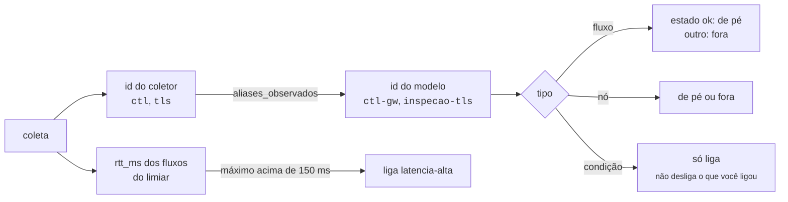

Fluxo medido sem correspondência no modelo aparece na evidência como "fora do modelo".

## O painel

**Veredito**: um bloco por perfil, com o status de cada estágio.

**Fluxo de rede**: o diagrama, pintado pelo perfil selecionado. Verde em uso, âmbar em uso
degradado, cinza liberado e ocioso, vermelho bloqueado.

**Validar uma mudança**: você descreve a mudança em texto e a IA traduz para o estado do modelo. Os
toggles mexem sozinhos, o motor recalcula e só então a IA escreve a leitura.

**Fatos do motor**: o que está bloqueado ou degradado, por qual causa e em qual zona. Calculado, sem
texto escrito à mão.

**Evidência medida**: o que veio do coletor. Sem coleta carregada, ele avisa que tudo na tela é o
modelo respondendo ao que você marcou, não o ambiente real.

<p align="center">
  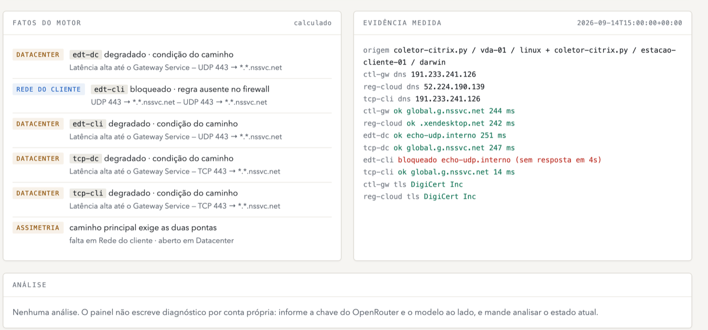
  <br><sub>Repare na assimetria: EDT aberto no datacenter e fechado no cliente. O grupo 1 do transporte exige as duas pontas.</sub>
</p>

**Análise**: a IA. Fica vazia até você mandar analisar.

**Varredura de falhas**: um ou dois eventos, com as duplas emergentes no topo.

## IA

A IA faz duas traduções e nenhuma decisão: texto para estado, e resultado para texto. Ela não pode
contradizer o veredito do motor, não pode citar número que não esteja no contexto, e cada causa que
ela levanta precisa dizer em que dado se apoia.

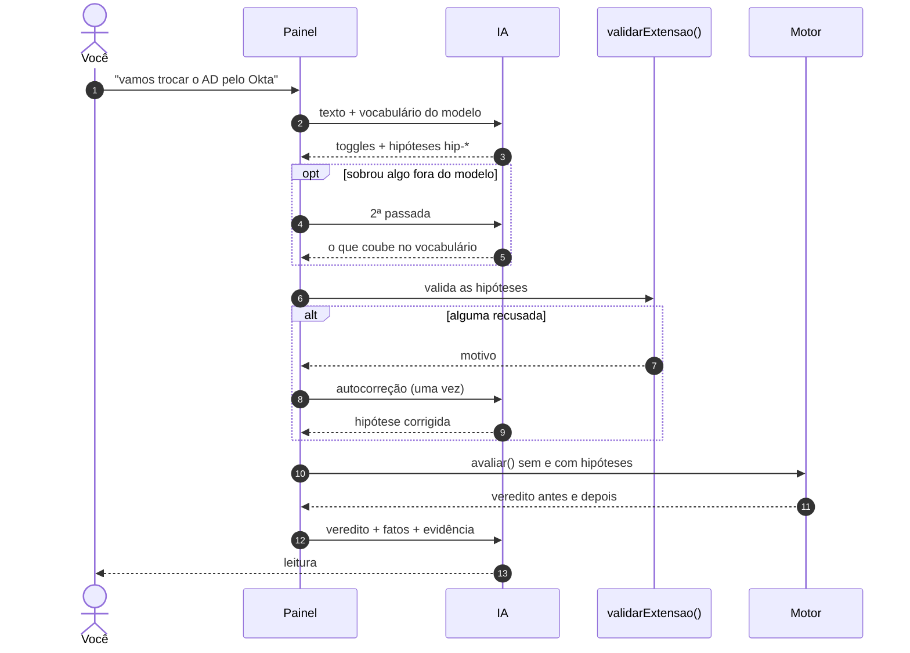

### Hipóteses

Quando a pergunta descreve algo que o modelo não tem, mas cujo efeito é bloquear ou degradar fluxos
que existem (SD-WAN sem UDP, firewall novo, QoS, proxy), a IA declara uma hipótese: uma condição
`hip-*` com o que ela bloqueia ou degrada e o porquê. A hipótese também pode trazer componente e
fluxo novos, como um proxy, um segundo Cloud Connector ou uma VPN até o VDA.

O critério para virar componente é de disponibilidade: se a coisa nova ficar fora do ar, alguma
etapa para de funcionar? Então é dependência. Trocar AD por Okta, por exemplo, vira o Okta como
dependência da autorização:

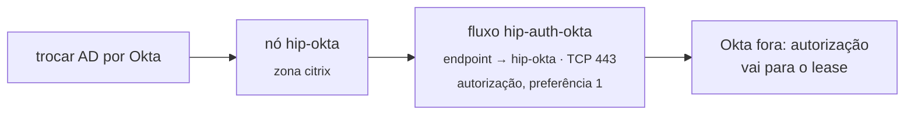

Federação, MFA e provisionamento ficam fora. Também fica fora o que muda a regra de avaliação
(estágio novo, lógica de decisão) ou o funcionamento interno de algo sem mudar do que ele depende,
como validade de token.

O validador recusa:

- id fora do padrão `hip-[a-z0-9-]+` ou repetido;
- zona, nó, estágio ou fluxo que não existe;
- protocolo diferente de TCP, UDP ou LOCAL, porta fora de 1 a 65535, preferência fora de 1 a 9;
- item sem nome ou sem justificativa;
- mais de 5 itens de um mesmo tipo;
- componente sem fluxo novo ligado a ele, porque não mudaria nada no motor;
- condição que bloqueia e degrada o mesmo fluxo.

A hipótese só acrescenta. Não remove nem redireciona fluxo existente: um proxy posto no meio de um
fluxo que já existe vira dependência adicional, e o fluxo antigo continua. Ela aparece separada, em
violeta, e o painel entrega a condição já no esquema do ambiente, com um caso de teste, para quem
for levar à topologia. Se a hipótese estiver errada o veredito também está, por isso a análise é
instruída a não usá-la como evidência.

### Chave

```bash
cp credenciais.local.json.exemplo credenciais.local.json
```
```json
{ "openrouter_key": "sk-or-v1-...", "modelo": "anthropic/claude-sonnet-5" }
```

O painel carrega esse arquivo ao abrir. Ele está no `.gitignore`, e o `gemeo-citrix.html` nunca
contém a chave. Sem o arquivo, dá para digitar no painel em *Fontes e integrações*; aí a chave fica
só na memória da aba.

## Medição

Este é um teste de cinco minutos com o coletor real rodando a cada 11 segundos e o painel aberto,
em 18/09 das 20h21 às 20h26. O gráfico é o maior RTT até o Gateway em cada coleta (eixo em mm:ss;
zero quando o nome nem resolveu):

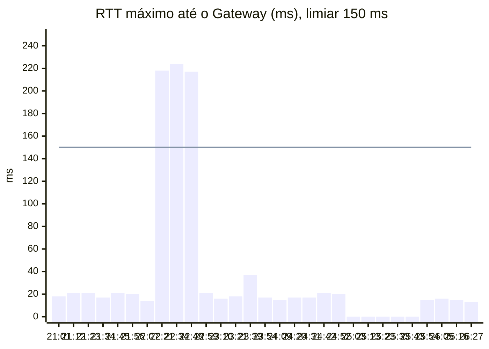

| mm:ss | coleta | veredito |
|---|---|---|
| 21:01 a 22:07 | RTT perto de 20 ms | íntegro nos dois perfis |
| 22:21 a 22:48 | RTT perto de 220 ms | degradado: `latencia-alta` ligou pelo limiar |
| 23:39 a 24:09 | `edt-dc` sem resposta | caminho alternativo, TCP 443 |
| 25:03 a 25:43 | `ctl-gw` e `reg-cloud` sem resolver | sessão nova interrompe no registro; sessão ativa íntegra |
| 25:54 em diante | normal | íntegro |

### Ciclo com medição ao vivo

Quatro terminais.

```bash
# 1 · refletor UDP
sudo python3 echo-udp.py

# 2 · painel
./iniciar.sh

# 3 · agente medindo de verdade
python3 agente.py --real --intervalo 10 \
  --customer-id SEU_CCID \
  --alvo ctl-gw=global.g.nssvc.net \
  --refletor-udp 127.0.0.1

# 4 · exercitar
sudo ./rede.sh latencia 200
sudo ./rede.sh normal
sudo ./rede.sh bloqueia-udp
sudo ./rede.sh normal
```

Espere dois ciclos do agente entre um comando e outro para o painel reagir.

O agente também reproduz estados já gravados, sem tocar na rede. É a opção quando a conexão não pode
ser variável de risco:

```bash
python3 agente.py --roteiro roteiro.json --intervalo 15 --repetir
```

O `roteiro.json` incluso é uma degradação progressiva:

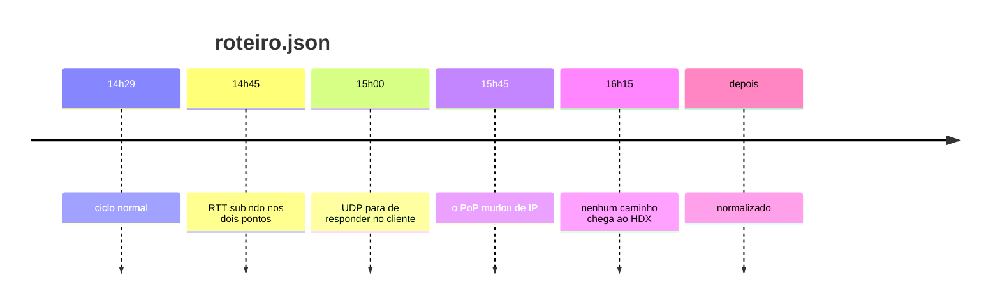

### Coletar do ambiente real

O modelo tem duas pontas saindo para o mesmo Gateway, e o EDT só sobe com UDP aberto nas duas. Um
coletor só enxerga um lado.

No VDA:

```bash
python3 coletor-citrix.py --customer-id SEU_CCID \
    --alvo ctl-gw=global.g.nssvc.net \
    --refletor-udp echo.seudominio.com \
    --saida estado-dc.json
```

Numa máquina da rede do cliente, pela mesma rota de saída do usuário:

```bash
python3 coletor-citrix.py --alvo tcp-cli=global.g.nssvc.net \
    --refletor-udp echo.seudominio.com \
    --saida estado-cliente.json
```

Juntar:

```bash
python3 twin.py merge estado-dc.json estado-cliente.json \
    --mapear ctl=ctl-gw --mapear reg=reg-cloud \
    --anonimizar --saida coletas/atual.json
```

O coletor grava ids genéricos (`ctl`, `reg`, `tls`, `proxy-tcp`) e cada ambiente traduz esses ids em
`aliases_observados`. Para qualquer outro, o id do `--alvo` precisa bater com o id de fluxo do
ambiente. O `--anonimizar` mascara o identificador de tenant nos FQDN, para material que vai virar
público.

Os requisitos de firewall da Citrix são wildcards, e wildcard não resolve:

- `*.*.nssvc.net` tem dois níveis de curinga. Um host real e resolvível do Gateway Service é `global.g.nssvc.net`.
- `*.xendesktop.net` responde sem registro para subdomínio inexistente. O alvo testável é `<CCID>.xendesktop.net`, com o Customer ID do Citrix Cloud.

Para descobrir qual PoP este host está usando de fato, com uma sessão aberta:

```bash
python3 coletor-citrix.py --descobrir
```

### Simular na própria máquina (macOS)

> [!WARNING]
> Os comandos abaixo mexem no firewall da sua máquina. Ensaie o desfazer antes de precisar dele.

| | ligar | desligar |
|---|---|---|
| latência | `sudo ./rede.sh latencia 200` | `sudo ./rede.sh normal` |
| perda de pacote | `sudo ./rede.sh perda 5` | `sudo ./rede.sh normal` |
| UDP 443 bloqueado | `sudo ./rede.sh bloqueia-udp` | `sudo ./rede.sh normal` |
| ver o que está ativo | `./rede.sh status` | |

O `delay` é por sentido e a regra é só de saída, então o RTT sobe cerca de 200 ms, não 400. Passando
de 150 ms, `latencia-alta` liga sozinha e o painel vai de íntegro para degradado.

O modelo não enxerga perda. O coletor mede o tempo de conexão, não a taxa de descarte; a sessão
degrada de verdade, mas o painel não reporta.

Para o bloqueio de UDP aparecer no painel, o UDP precisa estar sendo medido. Sem refletor o coletor
marca `nao-testado` e o campo nem entra no arquivo. Suba o `echo-udp.py` e aponte o coletor para ele
com `--refletor-udp`. Com refletor em loopback ou rede privada a medição sai com aviso: serve para
exercitar o modelo, não prova que a saída UDP 443 até o Gateway está aberta.

<details>
<summary><b>Os comandos por baixo do rede.sh</b></summary>

Latência. Os dois comandos são necessários: o `dnctl` cria o pipe, o `pfctl` manda o tráfego para
dentro dele.

```bash
sudo dnctl pipe 1 config delay 200
echo "dummynet out proto {tcp,udp} to any port 443 pipe 1" | sudo pfctl -f - -E
```

Perda de pacote:

```bash
sudo dnctl pipe 1 config plr 0.05
echo "dummynet out proto {tcp,udp} to any port 443 pipe 1" | sudo pfctl -f - -E
```

Bloquear UDP 443:

```bash
echo "block drop out proto udp to any port 443" | sudo pfctl -f - -E
```

Desfazer:

```bash
sudo pfctl -d
sudo dnctl -q flush
sudo pfctl -f /etc/pf.conf
```

Conferir o que está ativo:

```bash
sudo dnctl list
sudo pfctl -s info | head -2
sudo pfctl -s rules
```

O `-E` do `pfctl` conta referências: se você rodou o comando de ligar mais de uma vez, precisa de um
`pfctl -d` para cada vez, até o `pfctl -s info` dizer `Status: Disabled`. Se algo ficar estranho,
reiniciar o Mac devolve tudo; nada disso persiste.

</details>

## twin.py

```bash
python3 twin.py check ambiente-continuidade.json --cenarios cenarios-continuidade.json
python3 twin.py test casos-continuidade.json
```

O `check` procura referência quebrada, id repetido, estágio sem fluxo, nó órfão e cenário apontando
para coisa que não existe. O `test` roda os casos esperados contra o motor (hoje são 48, todos
passando). Os dois devolvem código de saída diferente de zero quando falham, então dá para pendurar
num hook de commit. Só o `check` funciona sem Node.

```bash
python3 twin.py eval ambiente-continuidade.json --no workspace
python3 twin.py eval ambiente-continuidade.json --fluxo edt-cli=off
python3 twin.py eval ambiente-continuidade.json --cond inspecao-tls=on
python3 twin.py eval ambiente-continuidade.json --observado coletas/atual.json
python3 twin.py eval ambiente-continuidade.json --extensao hipotese.json

python3 twin.py sweep ambiente-continuidade.json
python3 twin.py sweep ambiente-continuidade.json --profundidade 2 --mostrar-duplas
python3 twin.py sweep ambiente-continuidade.json --extensao hipotese.json
```

O `--observado` aplica a coleta pelo mesmo `aplicarObservado()` do painel, e os demais ajustes
entram por cima. O arquivo de `--extensao` tem o mesmo formato que a IA devolve:
`{"nos": [...], "fluxos": [...], "condicoes": [...]}`, com ids `hip-*`.

## Arquivos

```
gemeo-citrix.html             painel; o motor fica entre MOTOR:INICIO e MOTOR:FIM
iniciar.sh                    valida, sobe o servidor e abre o navegador

ambiente-continuidade.json    modelo principal: separa sessão nova de sessão em andamento
ambiente-rendezvous-v2.json   modelo do caminho de rede, sem os perfis de ciclo de vida
cenarios-continuidade.json    cenários do modelo principal
cenarios-rendezvous-v2.json   cenários do modelo base
casos-continuidade.json       casos esperados, usados pelo twin.py test

twin.py                       check, eval, sweep, test, merge             (sua máquina)
coletor-citrix.py             mede o caminho e grava o estado observado   (VDA e rede do cliente)
agente.py                     coleta em laço e publica coletas/atual.json (onde o coletor roda)
echo-udp.py                   refletor UDP; sem ele o UDP não é medido    (fora da rede testada)
rede.sh                       degrada ou bloqueia a rede local            (macOS)

coletas/                      histórico de estados observados; atual.json é o corrente
coletas/index.json            índice das coletas com data, pontos e contagem de falhas
roteiro.json                  sequência de estados para o agente reproduzir
credenciais.local.json        chave do OpenRouter, fora do repositório
docs/img/                     imagens deste README
```

Coletas reais carregam tenant e hostname. O `.gitignore` só deixa entrar os exemplos anonimizados de
`coletas/2026-09-14_*.json`.

## Limites do modelo

As premissas estão no topo de cada `ambiente-*.json`. As do modelo de continuidade: máquinas AD
domain joined, acesso via StoreFront Cloud e Gateway Service, Session Reliability habilitada,
autenticação federada no IdP não modelada, e o mesmo protocolo de transporte nas duas pernas (EDT
numa e TCP na outra conta como sem caminho, que é a hipótese que mais vale validar em laboratório).

O modelo ainda não foi confrontado com laboratório. Os casos em `casos-continuidade.json` dizem que
ele é coerente consigo mesmo, não que corresponde ao ambiente. Quando um teste real contradisser um
caso, corrija o modelo e o caso junto, para não regredir.

Pergunta aberta que não traduz para o estado é informação útil: cada uma delas é uma coisa que o
modelo deveria representar e não representa.
